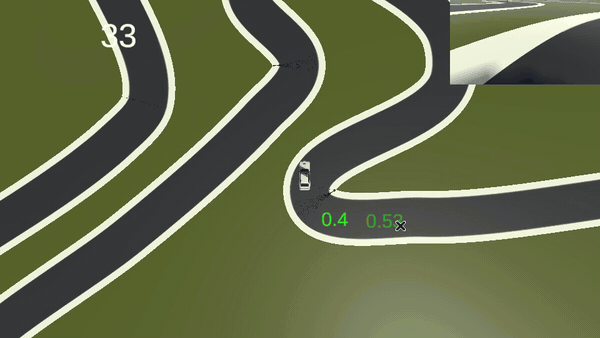
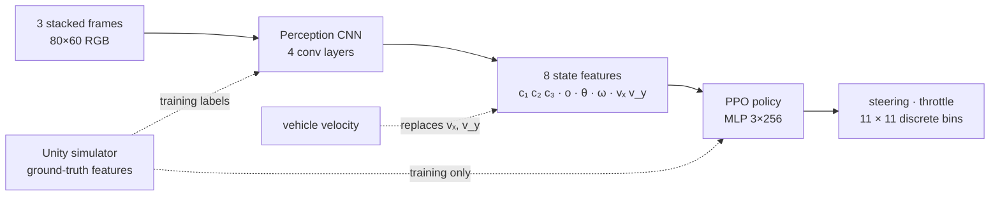
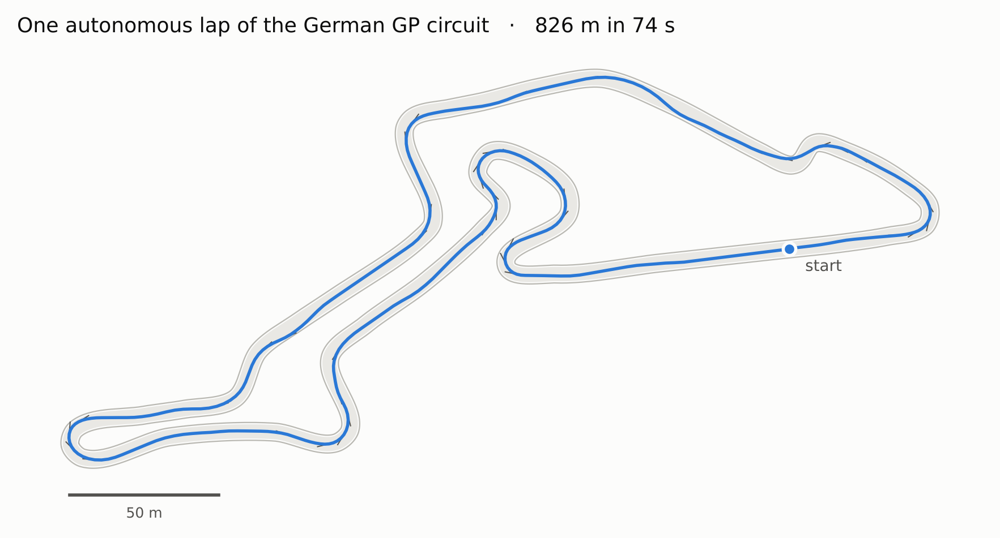
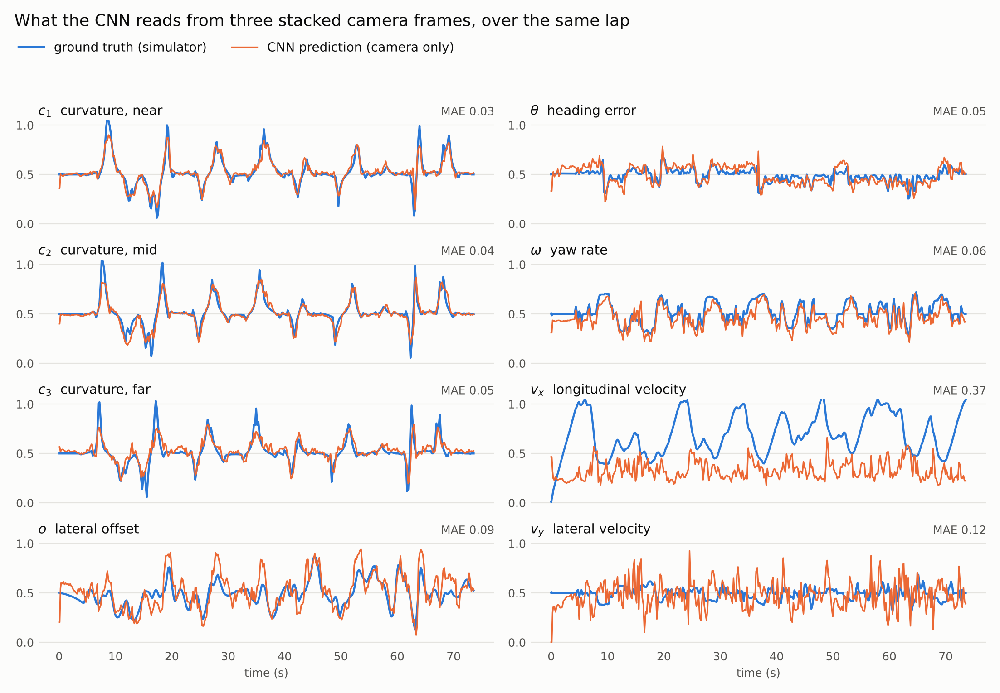
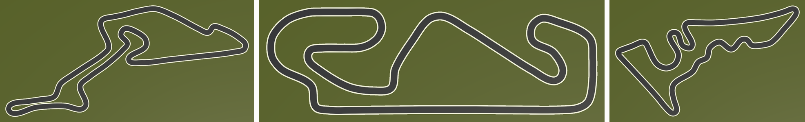
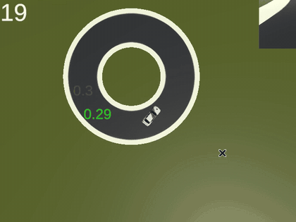
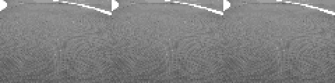
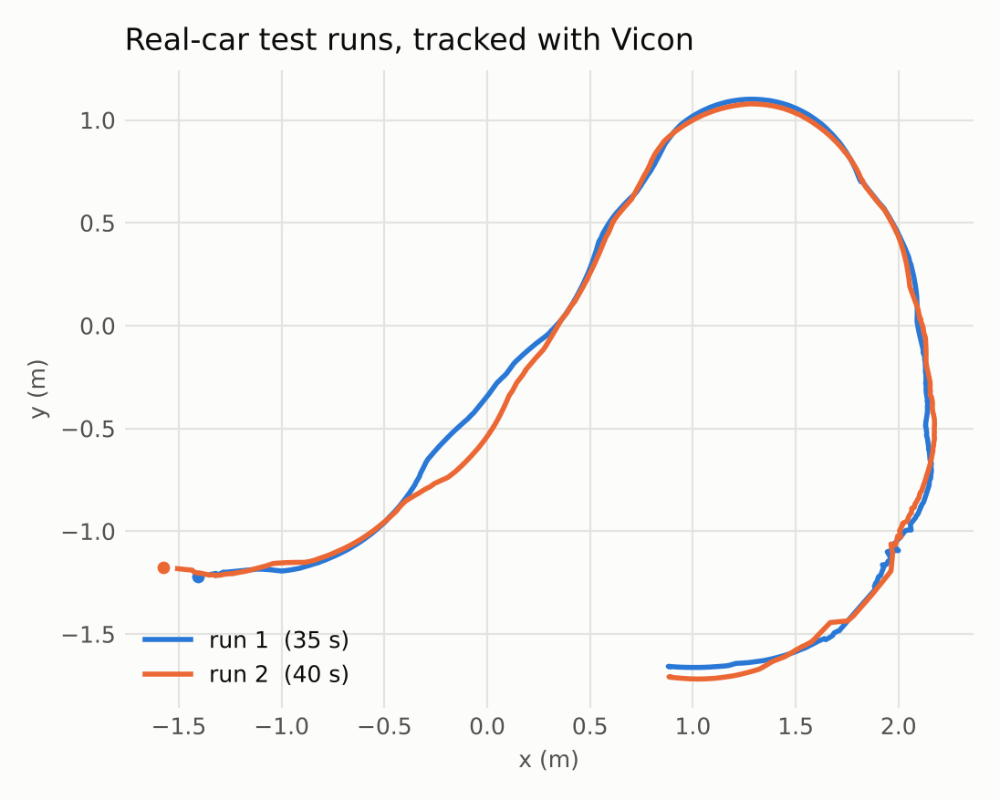

# ML Racing: learning to drive from a camera with deep RL

**Bachelor's thesis (2023).** I built a racing simulator in Unity, trained a reinforcement-learning
agent to drive F1 circuits in it, taught a CNN to perceive the track from an 80×60 camera, and ran
the result on a real 1:10 scale car.


<p align="center">
  
  <br>
  <sub>The trained agent on the German GP circuit, at real-time speed, with the onboard camera top-right. This 24-second section comes from a <a href="docs/media/sim_german_gp.mp4">61-second continuous run (MP4)</a>.</sub>
</p>

## Highlights

- **Drives a full F1 circuit autonomously**: one lap of the 826 m German GP layout in 74 s. It never strays more than 2.2 m from the centre line on a 6 m wide road.
- **Learns to see the track**: a CNN reads curvature, heading and lateral position from three stacked 80×60 camera frames.
- **Two-stage design**: the policy learns driving from clean simulator state, and the CNN learns perception separately. At run time the CNN replaces the simulator.
- **Drifting experiments**: a separate agent is rewarded for side-slip while staying on the track.
- **Sim-to-real**: perception and policy run as ONNX models inside a ROS 2 stack on an F1TENTH-style car, with Vicon motion capture for evaluation.

## The approach

My first attempts trained PPO directly on raw camera images (see the early commit history). The
final system splits the problem in two:



1. **Driving policy.** PPO (Stable-Baselines3) learns to drive from 8 features that the simulator
   computes exactly. These are the track curvature at three look-ahead points (c₁–c₃), the lateral
   offset from the centre line (o), the heading error (θ), the yaw rate (ω), and the longitudinal and
   lateral velocity (vₓ, v_y). The reward is speed multiplied by a centre-line term, and an episode
   ends when the car leaves the track.
2. **Perception.** A 4-layer CNN with batch norm and dropout regresses the same 8 features from the
   last three camera frames. It is trained supervised on images and labels recorded while driving in
   the simulator.
3. **Deployment.** The CNN's output replaces the simulator's features. Velocity is the one thing a
   camera can't judge well (see below), so when the CNN drives in simulation (`MixedWrapper`), vₓ
   and v_y come from the vehicle state instead.

## Results

### A full lap of the German GP

The trained policy completing a full lap of the German GP layout. The blue line is the car's path,
grey ticks mark its heading, and the shaded band is the 6 m wide road.

<picture>
  <source media="(prefers-color-scheme: dark)" srcset="docs/images/lap_german_gp_dark.png">
  
</picture>

### What the CNN sees

During the same lap, the CNN's predictions (orange) closely follow the simulator's ground truth
(blue) for track geometry and the car's pose. Speed is the exception: three low-resolution frames
carry little information about absolute velocity, which is why vₓ and v_y are taken from the
vehicle state instead.

<picture>
  <source media="(prefers-color-scheme: dark)" srcset="docs/images/cnn_features_dark.png">
  
</picture>

### Three circuits

The final simulator includes three F1-inspired layouts (German, Spanish and US Grand Prix). Each
episode starts at a random point, in a random direction, on one of the circuits. Earlier experiments
used procedurally generated circuits and circles.

<p align="center">
  
</p>

### Drifting

A separate agent (`DriftAgent`) is rewarded for side-slip angle as well as speed:
`reward = (0.4·velocity + 0.6·|slip|/max_slip) × centre-line term`. Here it holds a slide around a
small ring.

<p align="center">
  
</p>

### On the real car

The perception CNN and the policy were exported to ONNX and run on the car's onboard computer
inside ROS 2 nodes. Below is what the network actually receives on the car: three stacked 80×60
frames of the lab floor with a taped lane line. Below it are two test runs recorded with the
Vicon system.

<p align="center">
  
</p>

<p align="center">
  <picture>
    <source media="(prefers-color-scheme: dark)" srcset="docs/images/real_car_runs_dark.png">
    
  </picture>
</p>

## Under the hood

| Component | Details |
|---|---|
| **Simulator** | Unity 2021.3 with [Vehicle Physics Pro](https://vehiclephysics.com/) for tyre and drivetrain dynamics. Tracks are Bézier road meshes, modelled on F1 circuits (earlier experiments used procedurally generated ones). Track, spawn point and driving direction are random each episode. |
| **Agent interface** | Unity ML-Agents. Decisions at 5 Hz on 50 Hz physics, 8-dimensional observation, `MultiDiscrete([11, 11])` steering and throttle. |
| **RL** | PPO from Stable-Baselines3. MLP with 3–4 hidden layers of 256 units, `n_steps = 512`, γ = 0.999, learning rate 2·10⁻⁴ decaying linearly. Many simulator instances run in parallel. |
| **Perception** | PyTorch CNN: 9-channel input (3 RGB frames), 4 conv layers (32 → 256 channels) with batch norm and dropout, then a 512 → 128 → 8 head with sigmoid outputs. Trained on frames logged from the simulator over a TCP socket. |
| **Real car** | 1:10 F1TENTH-style platform (Jetson Nano, VESC). ROS 2 Humble nodes for the camera, perception, policy and logging; ROS 1 drivers and a Vicon bridge, all in Docker. See [docs/hardware-setup.md](docs/hardware-setup.md). |

## Repository layout

```
Assets/Code/        C# for the simulator: RaceAgent / DriftAgent (observations, rewards, resets),
                    RacetrackGenerator, simulated IMU, SocketSend (streams frames + labels to Python)
Assets/Scenes/      training scenes (driving, drifting, screenshots)
ML/                 training: train.py, env wrappers (MixedWrapper feeds CNN features to the policy),
                    final policies in models/last_archive, perception CNN in models/cnn_*
analysis/           drive logging, CNN feature evaluation, class-activation maps, figure scripts
                    (make_figures.py renders every chart in this README from analysis/compute_logs)
ros/                ROS 1 + ROS 2 Docker setup for the real car: camera / perception node,
                    policy node, VESC controller, Vicon bridge, run logs
docs/               figures, videos and the hardware bring-up notes
```

## Acknowledgements

Built with [Unity ML-Agents](https://github.com/Unity-Technologies/ml-agents),
[Stable-Baselines3](https://github.com/DLR-RM/stable-baselines3),
[Vehicle Physics Pro](https://vehiclephysics.com/) by Edy,
[Path Creator](https://github.com/SebLague/Path-Creator) by Sebastian Lague, and the
[F1TENTH](https://f1tenth.org/) platform and [`f1tenth_system`](https://github.com/f1tenth/f1tenth_system) drivers.
